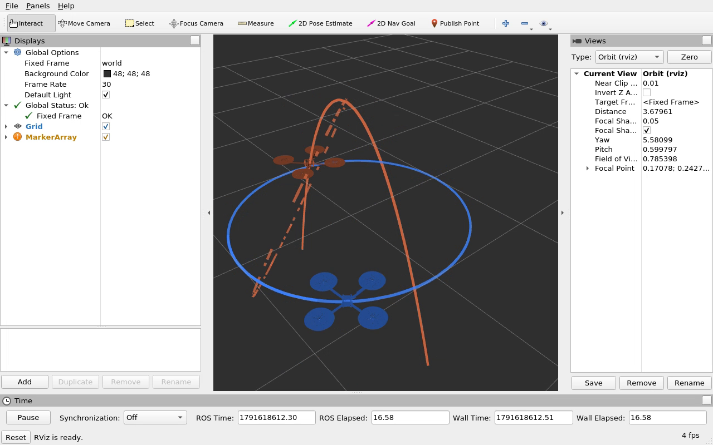
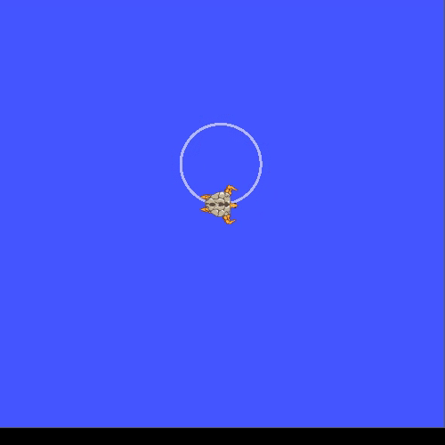

# Robot Lab 2: ROS transforms

Completed two-drone coordinate-transform exercise from [MIT VNAV Lab 2 (2023)](https://vnav.mit.edu/labs_2023/lab2/exercises.html). The ROS 1 package follows the [MIT-SPARK VNAV2023 source](https://github.com/MIT-SPARK/VNAV-labs/tree/VNAV2023/lab2); the supplementary ROS 2 package follows the repository's ROS 2 version. Both publish the prescribed world transforms and plot the two world trails plus the AV2-in-AV1 trail.

## Runtime video examples

Actual ROS Noetic recordings from AutoDL. Each silent H.264 MP4 lasts 15 seconds. Click a preview to open its video.

| Demonstration | Video |
| --- | --- |
| Two drone models and their coordinate-frame trajectories in RViz | [Watch / download MP4](videos/drones_rviz.mp4) |
| Turtlesim driven by ROS velocity commands on a circular path | [Watch / download MP4](videos/turtlesim_circle.mp4) |

[](videos/drones_rviz.mp4)

[](videos/turtlesim_circle.mp4)

See [video details and run commands](videos/README.md).

## ROS 1 Noetic (course version)

On Ubuntu 20.04 with ROS Noetic and `python3-catkin-tools`:

```bash
source /opt/ros/noetic/setup.bash
cd ros1_noetic
catkin init
catkin build
source devel/setup.bash
roslaunch two_drones_pkg two_drones.launch
```

Use `static:=true` for the fixed-frame scene. Run `roscore` first if it is not already active. The separate `ros1_noetic/turtle_circle.py` publishes a velocity command to turtlesim.

## ROS 2 Humble (supplementary version)

```bash
source /opt/ros/humble/setup.bash
cd ros2_humble
colcon build --packages-select two_drones_pkg
source install/setup.bash
ros2 launch two_drones_pkg two_drones.launch.yaml
```

Use `static:=true` for the fixed-frame scene. The separate `ros2_humble/turtle_circle.py` drives turtlesim.

## Verification and report

The Noetic package passed `catkin build` and live static/dynamic tests on an Ubuntu 20.04 root filesystem in AutoDL. The Humble package passed `colcon build` and equivalent live tests on the Ubuntu 22.04 host. The checker scripts in `checks/` verify transforms, visualization markers, trajectories, and quaternion identities. The ICRA-style report and its analytical figures are under `report/`. See `docs/` for cloud reproduction steps and scope details.

The two-drone scene publishes poses and visualization markers. It does not simulate or command physical quadrotors.
